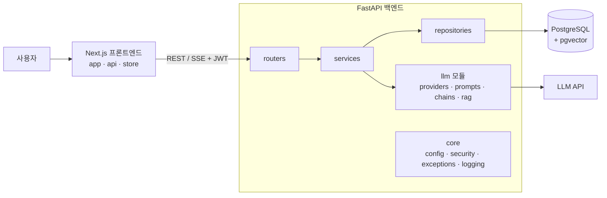
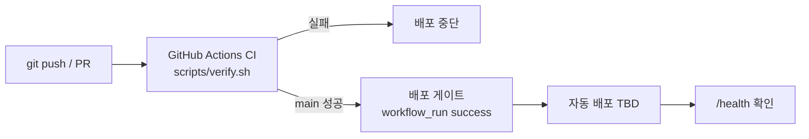

# 아키텍처

> 산출물 "스타터킷 설계서"의 ②·④ 항목 원본. 구현이 진행되면 함께 갱신한다.

## 전체 구성

## 배포 흐름

## 요청 흐름 (채팅 스트리밍)
1. 로그인 → access/refresh JWT 발급
2. 프론트가 `Authorization: Bearer`로 `POST /api/chat/{id}/stream` 호출
3. router가 토큰 검증 → `ChatService` 호출
4. service가 repository로 대화 이력 조회 → `get_chat_model()` + 프롬프트로 스트리밍 호출
5. 토큰을 SSE로 전달, 종료 시 assistant 메시지와 토큰 사용량 저장
6. 프론트가 토큰을 실시간 렌더링
